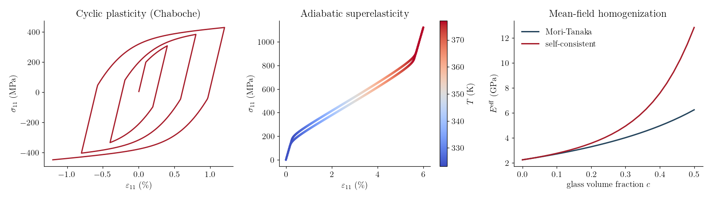

<p align="center">
  <a href="https://3mah.github.io/simcoon-docs/">
    
  </a>
</p>

<p align="center">
  <b>Constitutive laws, material-point simulation and mean-field micromechanics for nonlinear and heterogeneous materials.</b>
</p>

<p align="center">
  <a href="https://3mah.github.io/simcoon-docs/"></a>
  <a href="https://pypi.org/project/simcoon/"></a>
  <a href="https://anaconda.org/set3mah/simcoon"></a>
  <a href="https://github.com/3MAH/simcoon/blob/master/LICENSE"></a>
</p>

<p align="center">
  
</p>

**simcoon** is a C++ library with a Python interface. It provides constitutive
laws (elastoplasticity, viscoelasticity, hyperelasticity, shape memory alloys,
damage), a thermomechanical material-point solver under mixed strain and stress
control, finite-strain kinematics with several objective rates, and mean-field
homogenization of composites. Its laws serve as user materials in
[fedoo](https://github.com/3MAH/fedoo), Abaqus and Ansys, on microstructures
generated with [microgen](https://github.com/3MAH/microgen).

- **Constitutive laws**: isotropic and kinematic hardening (Chaboche, Johnson-Cook),
  anisotropic criteria, Prony viscoelasticity, hyperelastic potentials (Neo-Hookean,
  Mooney-Rivlin, Ogden, Holzapfel-Gasser-Ogden), shape memory alloys with
  transformation and reorientation.
- **Modular laws**: compose elasticity, criteria, hardening, viscoelastic and damage
  mechanisms from Python, without writing C++.
- **Finite strain**: logarithmic strain transported by the polar rotation (log_R,
  the default), Jaumann and Green-Naghdi rates, Kirchhoff stress, consistent tangents.
- **Thermomechanics**: coupled heat equation at the material point, energy balance.
- **Micromechanics**: Eshelby tensors, Mori-Tanaka and self-consistent schemes.
- **Identification**: fit parameters with `scipy.optimize` and the simcoon parameter keys.
- **Python and ML laws**: write a law in Python or plug a trained network into the same solver.

Hello, elastoplasticity
-----------------------

```python
import numpy as np
from simcoon import solver

props = np.array([70000.0, 0.3, 1.0e-5, 300.0, 1000.0, 0.3])  # E, nu, alpha, sigma_Y, k, m
load = solver.StepMeca(control="stress", value=[450.0, 0, 0, 0, 0, 0], ninc=100)
unload = solver.StepMeca(control="stress", value=[0.0, 0, 0, 0, 0, 0], ninc=100)

res = solver.solve(solver.Block(steps=[load, unload], ncycle=3), "EPICP", props, nstatev=8)
print(res["Strain"][0, -1], res["Stress"][0, -1])
```

`solver.solve` runs the loading blocks in memory and returns the whole history as
numpy arrays. The [gallery of examples](https://3mah.github.io/simcoon-docs/examples/index.html)
covers every family of laws, and the [list of constitutive laws](https://3mah.github.io/simcoon-docs/simulation/umat_catalog.html)
gives their parameters.

Documentation
-------------

The documentation is online at **https://3mah.github.io/simcoon-docs/**. To build it
locally (Sphinx, breathe and doxygen; the gallery runs the examples):

```bash
conda install -c conda-forge doxygen
pip install -r docs/requirements.txt
cd docs && make html   # then open _build/html/index.html
```

The 3MAH ecosystem
------------------

| | |
|---|---|
| [**microgen**](https://github.com/3MAH/microgen) | Geometry and periodic meshes of microstructures |
| [**fedoo**](https://github.com/3MAH/fedoo) | Nonlinear finite elements and periodic homogenization |
| **simcoon** | Constitutive laws and mean-field micromechanics |

Installation
------------

### Option 1: Install from Conda (Recommended)

The simplest way to install simcoon is directly with conda:

```bash
conda install -c conda-forge -c set3mah simcoon
```

In case of conflicts, create a new conda environment:
```bash
conda create --name simcoon_env
conda activate simcoon_env
conda install -c conda-forge -c set3mah simcoon
```

### Option 2: Install from PyPI

```bash
pip install simcoon
```

Prebuilt wheels are available for:
- Linux (x86_64, aarch64)
- macOS (arm64, requires macOS 14.0+)
- Windows (x64)

**If no compatible wheel is available** (e.g., older macOS versions), pip will attempt to build from source. In this case, install Armadillo (>= 12.6) first — it is the only system dependency not bundled in the wheels.

Using conda (requires `--no-build-isolation` so CMake can find conda packages):
```bash
conda install -c conda-forge armadillo
pip install scikit-build-core pybind11 numpy  # build dependencies
pip install simcoon --no-binary simcoon --no-build-isolation
```

Using apt (Debian/Ubuntu):
```bash
sudo apt-get install libarmadillo-dev
pip install simcoon --no-binary simcoon
```

BLAS and LAPACK are found automatically (Accelerate on macOS, system libraries on Linux).

### Option 3: Build from Source

#### Prerequisites

Create and activate a conda environment:
```bash
conda create --name simcoon_build
conda activate simcoon_build
```

Install required dependencies:
```bash
# Compilers and build tools
conda install -c conda-forge cxx-compiler fortran-compiler cmake ninja

# Libraries
conda install -c conda-forge armadillo pybind11 numpy gtest

# Python testing
pip install pytest
```

For x86 architectures, you may also need MKL:
```bash
conda install -c conda-forge mkl
```

#### Build Instructions (without conda)

1. Clone or download the repository:
```bash
git clone https://github.com/3MAH/simcoon.git
cd simcoon
```

2. Install required dependencies using your system's package manager.

- On Debian/Ubuntu:

```bash
sudo apt-get install libarmadillo-dev libgtest-dev ninja-build
```

- On macOS: use the conda environment (`environment_arm64.yml`, conda-forge armadillo and gtest). Do not use Homebrew packages inside a conda environment: they bring a second OpenMP runtime (see the installation docs, "Duplicate OpenMP runtimes on macOS"; check with `python -m simcoon.doctor`).

- On Windows with vcpkg:

```powershell
vcpkg install armadillo gtest
```

3. Configure and build the project:

**For Python users** (recommended):
```bash
pip install .
```

**For C++ development:**
```bash
# Configure and build
cmake -S . -B build -G Ninja -D CMAKE_BUILD_TYPE=Release
cmake --build build

# Run C++ tests
ctest --test-dir build --output-on-failure
```

#### Development Workflow

For active development with both C++ and Python:

```bash
# Install build dependencies first
uv pip install scikit-build-core pybind11 numpy

# Editable install (uv applies --no-build-isolation automatically via pyproject.toml)
uv pip install -e .[dev]

# After modifying C++ files, rebuild directly
cmake --build build/cp*

# Python changes take effect immediately (no rebuild needed)
```

The editable install creates a build directory at `build/{wheel_tag}` (e.g., `build/cp312-cp312-linux_x86_64`). The `[tool.uv]` config in `pyproject.toml` disables build isolation for simcoon, ensuring the CMake cache references your actual Python environment, enabling direct `cmake --build` commands for incremental rebuilds.

**Auto-rebuild on import**: Importing simcoon will automatically trigger a cmake rebuild if C++ files have changed:
```bash
python -c "import simcoon"  # Rebuilds if needed
uv run python -c "import simcoon"  # Also works
```

**Note**: If you add new C++ source files, re-run `uv pip install -e .[dev]` to reconfigure.

#### Build Options

- `SIMCOON_BUILD_TESTS` (default: ON) - Build C++ tests (CMake only)

#### Notes for macOS

For numpy versions earlier than 1.26.4 using the Accelerate framework:
```bash
pip install cython
pip install --no-binary :all: numpy
```


About
-----

simcoon is developed by the [3MAH](https://3mah.github.io/) group, mainly at
Université Grenoble Alpes (TIMC) and the University of Bordeaux (I2M), with
contributions from LEM3 (Metz) and TU Bergakademie Freiberg. It is released under
the GNU General Public License, version 3.

Authors
-------
* [Yves Chemisky](https://github.com/chemiskyy)
