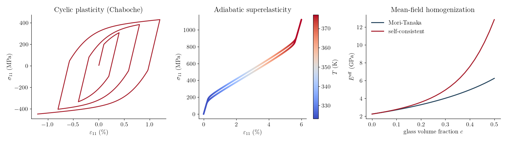

simcoon
=======

.. rst-class:: sc-tagline

   Constitutive laws, material-point simulation and mean-field micromechanics
   for nonlinear and heterogeneous materials.

**simcoon** is a C++ library with a Python interface. It provides
constitutive laws (elastoplasticity, viscoelasticity, hyperelasticity, shape
memory alloys, damage), a thermomechanical material-point solver under
mixed strain and stress control, finite-strain kinematics with several
objective rates, and mean-field homogenization of composites. Its laws serve
as user materials in `fedoo <https://3mah.github.io/fedoo-docs/>`_, Abaqus and
Ansys, on microstructures generated with
`microgen <https://3mah.github.io/microgen-docs/>`_.

.. container:: sc-buttons

   .. button-ref:: installation
      :ref-type: doc
      :color: primary
      :shadow:

      Install

   .. button-ref:: examples/index
      :ref-type: doc
      :color: primary
      :outline:

      Gallery of examples

   .. button-ref:: simulation/umat_catalog
      :ref-type: doc
      :color: secondary
      :outline:

      Constitutive laws

   .. button-link:: https://github.com/3MAH/simcoon
      :color: secondary
      :outline:

      GitHub

What you can do
---------------

.. grid:: 1 2 3 3
   :gutter: 3

   .. grid-item-card:: Elastoplasticity
      :img-top: examples/mechanical/images/thumb/sphx_glr_EPICP_thumb.png
      :link: sphx_glr_examples_mechanical_epicp.py
      :link-type: ref
      :class-card: sc-card

      Isotropic and kinematic hardening (Chaboche, Johnson-Cook), anisotropic
      criteria, cyclic loading under mixed control.

   .. grid-item-card:: Modular laws
      :img-top: examples/mechanical/images/thumb/sphx_glr_MODUL_thumb.png
      :link: sphx_glr_examples_mechanical_modul.py
      :link-type: ref
      :class-card: sc-card

      Compose elasticity, criteria, hardening, viscoelastic and damage
      mechanisms from Python, without writing C++.

   .. grid-item-card:: Finite strain
      :img-top: examples/analysis/images/thumb/sphx_glr_objective_rates_thumb.png
      :link: sphx_glr_examples_analysis_objective_rates.py
      :link-type: ref
      :class-card: sc-card

      Logarithmic strain transported by the polar rotation (log_R), Jaumann
      and Green-Naghdi rates, Kirchhoff stress and consistent box tangents.

   .. grid-item-card:: Hyperelasticity
      :img-top: examples/hyperelasticity/images/thumb/sphx_glr_GOH2006_tube_inflation_thumb.png
      :link: sphx_glr_examples_hyperelasticity_goh2006_tube_inflation.py
      :link-type: ref
      :class-card: sc-card

      Neo-Hookean, Mooney-Rivlin, Ogden and fibre-reinforced (HGO) potentials
      for soft tissues and elastomers.

   .. grid-item-card:: Thermomechanics and SMA
      :img-top: examples/thermomechanical/images/thumb/sphx_glr_SMA_T_thumb.png
      :link: sphx_glr_examples_thermomechanical_sma_t.py
      :link-type: ref
      :class-card: sc-card

      Coupled heat equation at the material point, shape memory alloys with
      transformation and reorientation, energy balance.

   .. grid-item-card:: Micromechanics
      :img-top: examples/heterogeneous/images/thumb/sphx_glr_effective_props_thumb.png
      :link: sphx_glr_examples_heterogeneous_effective_props.py
      :link-type: ref
      :class-card: sc-card

      Eshelby tensors, Mori-Tanaka and self-consistent schemes, effective
      properties of particle and fibre composites.

   .. grid-item-card:: Parameter identification
      :img-top: examples/identification/images/thumb/sphx_glr_chaboche_cyclic_identification_thumb.png
      :link: sphx_glr_examples_identification_chaboche_cyclic_identification.py
      :link-type: ref
      :class-card: sc-card

      Fit material parameters on experimental curves with ``scipy.optimize``
      and the simcoon parameter keys.

   .. grid-item-card:: Python and ML laws
      :img-top: examples/ml/images/thumb/sphx_glr_pyumat_numpy_j2_thumb.png
      :link: sphx_glr_examples_ml_pyumat_numpy_j2.py
      :link-type: ref
      :class-card: sc-card

      Write a constitutive law in Python or plug a trained network, and run
      it in the same solver as the C++ laws.

   .. grid-item-card:: Tensors and rotations
      :img-top: examples/continuum_mechanics/images/thumb/sphx_glr_tensor_thumb.png
      :link: sphx_glr_examples_continuum_mechanics_tensor.py
      :link-type: ref
      :class-card: sc-card

      Typed second- and fourth-order tensors in Voigt notation, rotations,
      push-forward and pull-back, stress measures.

Hello, elastoplasticity
-----------------------

.. code-block:: python

   import numpy as np
   from simcoon import solver

   props = np.array([70000.0, 0.3, 1.0e-5, 300.0, 1000.0, 0.3])  # E, nu, alpha, sigma_Y, k, m
   load = solver.StepMeca(control="stress", value=[450.0, 0, 0, 0, 0, 0], ninc=100)
   unload = solver.StepMeca(control="stress", value=[0.0, 0, 0, 0, 0, 0], ninc=100)

   res = solver.solve(solver.Block(steps=[load, unload], ncycle=3), "EPICP", props, nstatev=8)
   print(res["Strain"][0, -1], res["Stress"][0, -1])

:func:`simcoon.solver.solve` runs the loading blocks in memory and returns
the whole history as numpy arrays. See :doc:`simulation/python_solver` for
the loading objects and :doc:`simulation/umat_catalog` for the list of laws
and their parameters.

Install
-------

.. tab-set::

   .. tab-item:: conda

      .. code-block:: bash

         conda install -c conda-forge -c set3mah simcoon

   .. tab-item:: pip

      .. code-block:: bash

         pip install simcoon

See :doc:`installation` for building from source and the C++ library.

The 3MAH ecosystem
------------------

.. grid:: 1 1 3 3
   :gutter: 3

   .. grid-item-card:: microgen
      :link: https://3mah.github.io/microgen-docs/
      :class-card: sc-card

      Geometry and periodic meshes of microstructures.

   .. grid-item-card:: fedoo
      :link: https://3mah.github.io/fedoo-docs/
      :class-card: sc-card

      Nonlinear finite elements and periodic homogenization.

   .. grid-item-card:: simcoon
      :class-card: sc-card sc-card--current

      Constitutive laws and mean-field micromechanics.

About simcoon
-------------

simcoon is developed by the `3MAH <https://3mah.github.io/>`_ group, mainly
at Université Grenoble Alpes (TIMC) and the University of Bordeaux (I2M),
with contributions from LEM3 (Metz) and TU Bergakademie Freiberg. It is
released under the GPL-3.0 license. See :doc:`about` for the history and
the contributors.

.. toctree::
   :hidden:
   :maxdepth: 1
   :caption: Getting started

   about
   installation

.. toctree::
   :hidden:
   :maxdepth: 2
   :caption: Examples

   examples/index

.. toctree::
   :hidden:
   :maxdepth: 2
   :caption: User guide

   simulation/index
   continuum_mechanics/index
   homogenization/index
   external

.. toctree::
   :hidden:
   :maxdepth: 1
   :caption: Reference

   cpp_api/index
